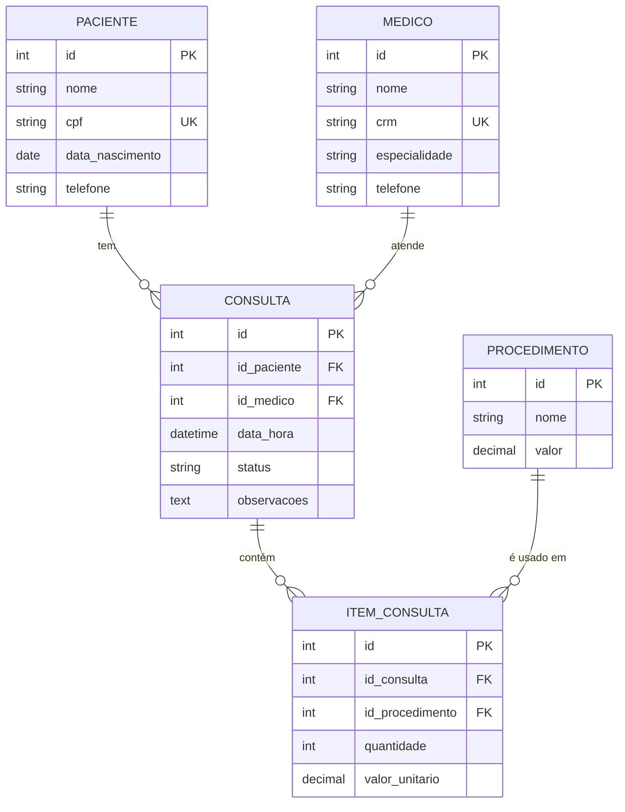

# Sistema de Clínica Médica

Sistema desktop em **Java (Swing)** com banco de dados **MySQL**, desenvolvido como atividade da disciplina de Banco de Dados com Java e Swing.

- **Aluno(a):** [Nome completo]
- **Turma:** [Turma]
- **Tema:** Clínica médica (cadastros, agendamento de consultas e procedimentos realizados)

## Objetivo

Permitir que uma clínica cadastre pacientes, médicos e procedimentos, agende consultas e registre, em cada consulta, os procedimentos realizados com quantidade e valor, calculando o total.

## Funcionalidades

- **Pacientes:** cadastrar, consultar, alterar e excluir.
- **Médicos:** cadastrar, consultar, alterar e excluir.
- **Procedimentos (serviços):** cadastrar, consultar, alterar e excluir.
- **Consultas:** agendar, consultar, alterar e excluir, vinculando paciente e médico, com data, hora, status e observações.
- **Itens da consulta:** adicionar e remover procedimentos de uma consulta, com quantidade, valor unitário, subtotal e total, na tela de lista de consultas.
- Validação de campos obrigatórios, de datas e de valores.
- Preservação da consistência dos relacionamentos (veja *Regras de consistência*).

## Entidades e relacionamentos

| Entidade | Papel no sistema |
|---|---|
| `paciente` | Participante das consultas |
| `medico` | Profissional responsável pela consulta |
| `procedimento` | Serviço oferecido pela clínica (catálogo) |
| `consulta` | Operação principal |
| `item_consulta` | Itens da operação (procedimento, quantidade e valor) |



## Regras de consistência

- Uma consulta está sempre vinculada a um paciente e a um médico cadastrados (chaves estrangeiras).
- Um paciente pode ter várias consultas, e um procedimento pode aparecer em várias consultas.
- Cada item pertence a uma única consulta e referencia um procedimento cadastrado.
- Ao excluir uma consulta, seus itens são excluídos junto (`ON DELETE CASCADE`).
- Não é possível excluir paciente, médico ou procedimento que já estejam em uma consulta.
- CPF e CRM não podem se repetir.
- O valor unitário é gravado no item, então alterar o preço do procedimento não muda consultas antigas.
- Uma consulta só pode ser marcada como **Realizada** se tiver ao menos um item.
- O último item de uma consulta não pode ser removido.

## Tecnologias

- Java (JDK 8 ou superior)
- Swing (interface gráfica)
- MySQL / MariaDB (via XAMPP)
- JDBC com MySQL Connector/J 8.0.18 (pasta `lib`)
- NetBeans IDE

## Estrutura do projeto

```
├── src
│   ├── conexao     # classe Conexao (conexão JDBC com o banco)
│   ├── beans       # classes das entidades (atributos, getters e setters)
│   ├── dao         # classes de acesso ao banco (CRUD com PreparedStatement)
│   └── (padrão)    # telas Swing: TelaMenu, TelaPacientes, TelaMedicos,
│                   # TelaProcedimentos, TelaConsultas, TabelaConsultas
├── lib             # driver mysql-connector-java-8.0.18.jar
├── nbproject       # configuração do NetBeans
├── build.xml
└── banco.sql       # script de criação do banco e das tabelas
```

O projeto segue a separação em camadas: as **telas** chamam os **DAOs**, que executam o SQL usando a **Conexao** e devolvem objetos **beans**.

## Como executar

1. **Banco de dados**
   - Abra o XAMPP e inicie o **MySQL** e o **Apache**.
   - Acesse `http://localhost/phpmyadmin`.
   - Importe o arquivo `banco.sql` (aba *Importar*), que cria o banco `clinica`, as 5 tabelas e alguns dados de teste.
2. **Projeto**
   - No NetBeans, use *Arquivo → Abrir Projeto* e selecione a pasta do projeto.
   - Confira que o `mysql-connector-java-8.0.18.jar` aparece em *Bibliotecas* (ele está em `lib`).
3. **Execução**
   - Execute a classe `TelaMenu` (botão direito → *Executar Arquivo*).

A conexão usa, por padrão, o banco `clinica`, o usuário `root` e senha vazia (padrão do XAMPP). Para mudar, edite `src/conexao/Conexao.java`.

## Possíveis melhorias

- Alterar a quantidade de um item já lançado na consulta.
- Gerar comprovante da consulta em PDF.
- Enviar os dados da consulta por e-mail.
- Salvar imagens (por exemplo, foto do paciente).
